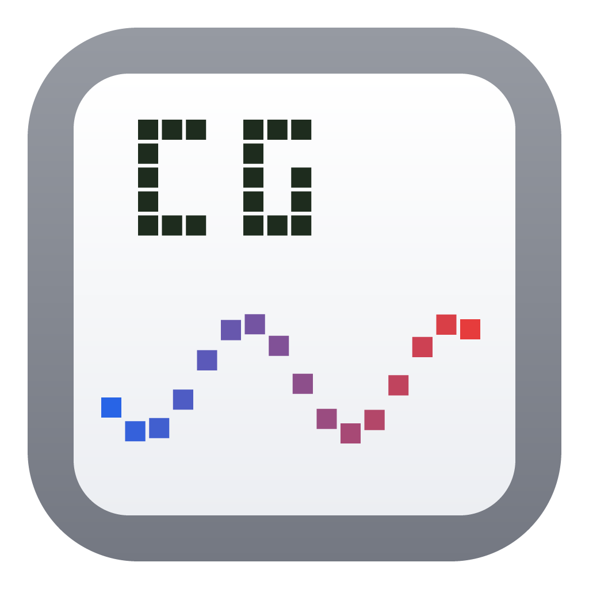
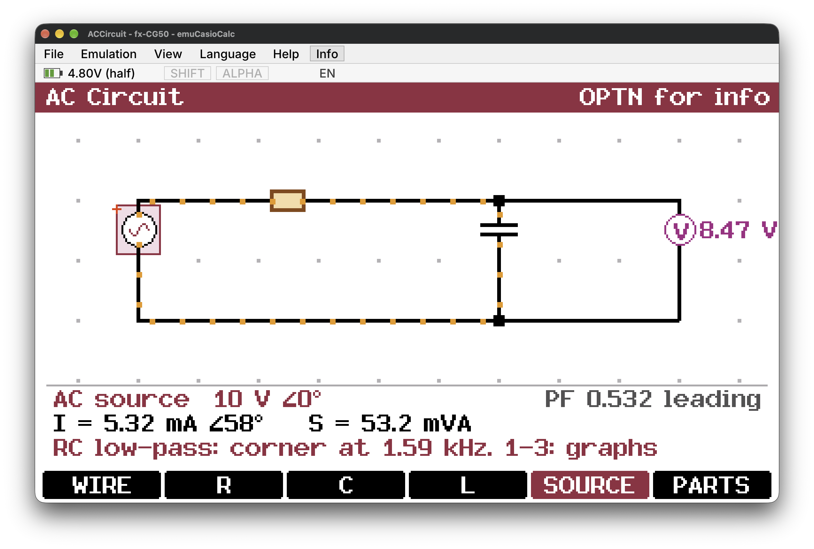
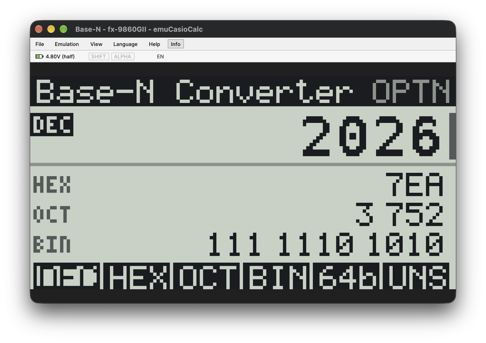
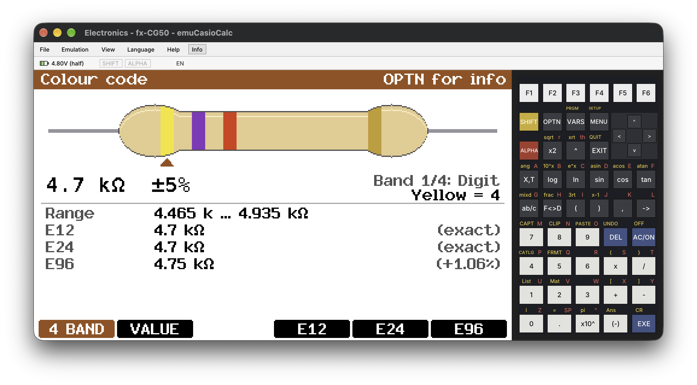

<div align="center">



# emuCasioCalc

**An emulator for Casio fx-CG50 / fx-CG10 / fx-CG20 (Prizm) add-ins, and gint add-ins for the monochrome fx-9860G models, on Linux and macOS**

Runs `.g3a` add-ins on a PC: OS-based ones (libfxcg / PrizmSDK) and gint
ones (fxSDK), plus monochrome `.g1a` gint add-ins for the fx-9860GII and
fx-9750GIII / Graph 35+E II, with hot reload, GIF recording, scripted
demos, the on-screen keyboard, Casio's own fonts from your OS dump, and a
live view of a real calculator's screen over USB.


-2ea44f)






<sub>A monochrome <code>.g1a</code> add-in on the fx-9860GII, and the fx-CG50 with the on-screen keyboard.</sub>


<sub>Add-ins from <a href="https://github.com/joserodpt/casioCalcApps">casioCalcApps</a>, recorded headless by the emulator from a key script.</sub>

</div>

## What it does

It does not boot the calculator's OS. It runs the add-in's SH4AL-DSP machine
code on an interpreter and handles two kinds of add-ins:

| Add-ins | How they run |
|---|---|
| **OS-based** (libfxcg / PrizmSDK) | Whenever the add-in calls the OS (jumps to `0x80020070` with a syscall number in `r0`), that syscall is implemented on the host instead (high-level emulation). **193 of the 273** OS functions known to the [libfxcg](https://github.com/Jonimoose/libfxcg) SDK are implemented; [`TODO.md`](TODO.md) lists the rest, by how likely add-ins are to need them. |
| **gint** (most modern Planète Casio add-ins, built with the fxSDK) | gint takes over the hardware, so the emulator models the parts of the SH7305 it drives: interrupt controller, timers, RTC, DMA, key scan interface, clock registers, exceptions and the R61524 display controller. |
| **Monochrome** (`.g1a`: gint ones from `fxsdk build-fx`, and Casio SDK / fxlib ones) | The SH4-based fx-9860G models have the same SH7305, with a 128x64 T6K11 display (both of its versions) and 512 kB of RAM; gint's grey engine shows four shades. Their OS's functions are implemented as on the fx-CG, starting with what gint and a few classic SDK games use (display, text, keys, files, timers, RTC, main memory), and the SH3 keyboard ports and watchdog that old SDK add-ins scan the keys with. |

| Feature | |
|---|---|
| **Hot reload** | Rebuild the add-in and it is loaded again on its own |
| **Screen recording** | File > Record GIF, or `--record` headless from a key script |
| **Sound** | What add-ins play through the 2.5 mm link jack (the serial port's TX pin), on your speakers or into a `.wav` with `--audio-out` |
| **Scripted demos** | `--script`: keys, waits and screenshots, the same files every run |
| **Show calculator's screen** | A real calculator's screen, live over USB (Screen Receiver mode or gint add-ins) |
| **Copy add-in to calculator** | Sends the running `.g3a` to a calculator in USB Flash mode, then ejects it |
| **Casio's fonts** | Read from a dump of your calculator's OS, so text looks as on the calculator |
| **On-screen keyboard** | The fx-CG50's keys, with SHIFT and ALPHA functions; click to press |
| **Models and timing** | fx-CG50 or fx-CG10/20 (detected), fx-9860GII or fx-9750GIII for `.g1a`, realistic or fast timing, 10%-400% speed |
| **Languages** | The OS messages in English, Spanish, German, French, Portuguese and Chinese |

## Building and running

You need CMake, SDL3 and Python 3 (`brew install cmake sdl3` on macOS; on
Linux, SDL3 from your package manager or from source, then pass
`-DCMAKE_PREFIX_PATH=<prefix>`).

```sh
cmake -S . -B build
cmake --build build
ctest --test-dir build --output-on-failure

./run.sh                  # rebuilds if the sources changed, opens an empty window (File > Open)
./run.sh some-addin.g3a   # same, starting that add-in (quote paths with spaces)
```

<details>
<summary><b>Command-line options</b></summary>
<br>

```sh
./build/emucasiocalc build/hello.g3a            # window; ESC = EXIT key
./build/emucasiocalc --trace some-addin.g3a     # log every syscall
./build/emucasiocalc --trace-hw some-addin.g3a  # log exceptions, DMA, unmodelled I/O
./build/emucasiocalc --headless --keys EXE,EXIT --screenshot out.bmp some-addin.g3a
./build/emucasiocalc --icon icon.bmp some-addin.g3a     # also save the add-in's menu icon
./build/emucasiocalc --info some-addin.g3a              # open the add-in info window at start
./build/emucasiocalc --model cg20 some-addin.g3a        # force the fx-CG10/20 (default: detect)
./build/emucasiocalc --timing fast some-addin.g3a       # no OS/memory/DMA delays (default: realistic)
./build/emucasiocalc --speed 50 some-addin.g3a          # half speed (10-400, or max)
./build/emucasiocalc --record demo.gif some-addin.g3a   # record the screen until the window closes
./build/emucasiocalc --headless --script demo.txt --record demo.gif some-addin.g3a  # a scripted demo
```

Also: `--keyboard` (show the on-screen keyboard), `--window-shot F` (save the
whole window, keyboard included, as a .bmp), `--font`, `--language
en|es|de|fr|pt|zh`, `--battery low` or `--battery 4.6`, `--os-dump F`,
`--clock "2026-01-01 12:00"`, `--device-id 0123456789ABCDEF`, `--ui-scale 2`,
`--install-desktop`, `--export-icon F.png`.

</details>

### The window

The window has a menu bar: **File** (open another add-in, add-in info, save a
screenshot, record a GIF, save the add-in's icon, copy the add-in to a
calculator, show a calculator's screen), **Emulation** (pause, reset, model,
timing, speed, battery), **View** (zoom 1x-6x, 4x the first time; keyboard;
font), **Language** and **Help**, plus an **Info** button.

Shortcuts: Ctrl+O, Ctrl+I, Ctrl+S, Ctrl+G, Ctrl+P, Ctrl+R, Ctrl+K, Ctrl+1..6,
Ctrl+Q. When the add-in exits, the window stays open so you can reset or open
another. If it stops with an error, the error is printed on the terminal and
shown on the screen in a red-bordered box.

**Add-in info** (the Info button, Ctrl+I) shows the add-in's name, header
fields and icon (hover the icon to see its selected version; the name on it
is the one for the chosen language, as in the main menu), its name in each
language (the header's labels; one row when they are all the same, Chinese
characters shown as `?`), and its controls: the calculator keys it uses with
the PC key for each, when they can be found in its code (add-ins using the
OS's GetKey), or the whole key table otherwise.

The **status row** under the menu bar shows SHIFT, ALPHA, the battery, the
message language and the add-in's status message (leaving out what the
screen's own status area already shows).

### Keyboard

| PC key | Calculator key | PC key | Calculator key |
|---|---|---|---|
| Arrows | arrows | F1–F6 | F1–F6 |
| Enter | EXE | Esc | EXIT |
| Backspace | DEL | Delete | AC/ON |
| Home | MENU | Tab | SHIFT |
| Left Alt | ALPHA | O | OPTN |
| V | VARS | digits, `. + - * / ( ) ,` | the same keys |
| E | ×10^x | U | (-) |
| X | X,θ,T | L / N | log / ln |
| S / C / T | sin / cos / tan | F | a b/c |
| D | F↔D | A | → |
| Q | x² | P | ^ |

Help > Keyboard controls lists them too. In OS add-ins, `GetKey` handles
SHIFT and ALPHA like the calculator: the next key returns its yellow or red
function (ALPHA 7 = `M`, SHIFT EXIT = QUIT), and SHIFT then ALPHA locks
ALPHA. With ALPHA on, PC letters and space type those characters directly.
gint add-ins read the keyboard themselves and see SHIFT and ALPHA as plain
keys; the window follows them with the OS's rules, which most add-ins share,
so PC letters work there too.

**On-screen keyboard** (View > Keyboard, Ctrl+K, or `--keyboard`; hidden at
first): the fx-CG50's keys right of the screen, with each key's SHIFT
function (yellow) and ALPHA letter (red) above it. Click a key to press it
(held while the mouse button is); keys light up while pressed, from the
mouse, the PC keyboard or `--keys`.

## Features

<details>
<summary><b>Hot reload</b>: edit, build and see the result</summary>
<br>

While an add-in runs, the emulator watches its `.g3a` file; when a build
replaces it (`fxsdk build-cg`), the add-in is loaded again on its own, so
edit, build and see the result without touching the emulator. File > Reload
when the file changes turns it off.

</details>

<details>
<summary><b>Screen recording</b>: animated GIFs of the screen</summary>
<br>

File > Record GIF (Ctrl+G; again to stop) records the calculator screen as an
animated GIF, `recording-<date>-<time>.gif` in the directory you run the
emulator from, with the menu bar showing `REC` and the time. It plays at the
pace the window showed it (time paused with Emulation > Pause is left out),
each screen pixel as 2 x 2, looping. Frames less than 20 ms apart are merged,
as browsers slow shorter ones down. Colours are exact for screens with up to
255 of them, and reduced (median cut) beyond. `--record F.gif` records from
the first frame until the window closes, or with `--headless` until the run
ends.

</details>

<details>
<summary><b>Sound</b>: the link jack's TX pin, on your speakers</summary>
<br>

The calculator has no speaker, but add-ins can play tones through the 3-pin
link jack by switching the serial port's TX pin, either directly (SCSPTR,
from a timer) or by streaming bytes through the UART as a 1-bit
delta-sigma signal (like the
[tone generator](https://github.com/joserodpt/casioCalcApps/tree/main/apps/tone-generator)).
The emulator records each change of the pin at the CPU cycle it happens
(bytes leave at the baud rate, and SCFDR counts the ones still waiting, as
on the calculator) and plays the result as a resistor and capacitor on the
jack would: averaged over each sample, low-passed at 15 kHz, without the
3.3 V DC. Sine waves made with delta-sigma therefore have the same hiss as
on the real thing.

Emulation > Sound turns it off. At other speeds the pitch follows (half
speed plays an octave lower), and at the fastest speed it is silent.
`--audio-out F.wav` writes it to a 48 kHz WAV file, in emulated time, also
headless:

```sh
./build/emucasiocalc --headless --audio-out tone.wav --keys "EXE,EXE,wait 2s,EXE,EXIT,EXIT" Tone.g3a
```

</details>

<details>
<summary><b>Scripted demos and screenshots</b>: the same files every run</summary>
<br>

`--script F` runs the steps in file F (and `--keys` takes the same steps), so
a demo GIF and showcase screenshots can be made without anyone at the
keyboard:

```sh
# demo.txt
wait 1s
shot ready.png        # screenshot: .png (or .bmp), 2x
EXE                   # keys by name: EXE, EXIT, F1, UP, 7, SHIFT...
wait 3s
shot running.png
scale 1               # the next screenshots at 1x
shot "small one.png"  # quotes for names with spaces
```

```sh
./build/emucasiocalc --headless --clock "2026-01-01 12:00" --script demo.txt --record demo.gif addin.g3a
```

Steps run in order, on the emulated clock: `wait N` (ms, or `2s`, `1.5s`)
lets time go on, with the add-in running (or its OS timers, while it waits
in GetKey); `shot F` saves the screen as it is. A key GetKey took counts as
done once the add-in is back in GetKey (its screen redrawn), or after
100 ms; put a `wait` before a screenshot to let an animation play. If the
add-in exits first, the screenshots left are taken of its last screen and
the waits left make the recording's last frame last; keys left are
reported. Headless, the run goes as fast as it can while the recording
keeps the emulated pace, and `--clock` starts the calculator's clock at a
fixed date and time, so the same script gives the same files each time.
The run exits with status 1 if a screenshot couldn't be saved.
`--screenshot F.png` saves the last frame as a PNG too.

`--keys` (and `--script`) works for both kinds of add-ins: OS `GetKey` calls
pop the keys in order; for gint add-ins each key is held down for 100 ms of
emulated time while the add-in reads the keyboard (not while it is in the
OS world, where its `GetKey` calls take them). Headless gint runs stop 0.5 s
(emulated) after the end of the script.

</details>

<details>
<summary><b>Show calculator's screen (USB)</b>: a real calculator, live in the window (Linux)</summary>
<br>

File > Show calculator's screen (USB) shows a real calculator's screen live
in the window, as Casio's Screen Receiver program does. Plug the calculator
in by USB and choose **Screen Receiver** (or **Projector**) on it, then pick
the menu item; the item is checked while it runs, and picking it again stops
it. Meanwhile the add-in is paused and the menu bar shows CALCULATOR; Save
screenshot and Record GIF save the calculator's screen. It keeps waiting for
the calculator until stopped, so it can be unplugged, or switch modes,
meanwhile.

**gint add-ins** can be shown too, if they open their USB link and send
frames (`usb_open` with `usb_ff_bulk`, then
`dupdate_set_hook(GINT_CALL(usb_fxlink_videocapture, 0))`, or a hook that
doesn't wait as casioCalcApps' `usb_screen.c` does): starting one ends
Screen Receiver mode, and the calculator comes back as gint's fxlink device,
whose "video" messages are shown.

In Screen Receiver mode the calculator is a USB drive (`07cf:6102`) that also
answers three Casio SCSI commands, and sends
[Protocol 7.00 screenstreaming](https://cahute.org/topics/protocols/seven-ohp.html)
frames (384x216, 16-bit colour) each time its screen changes. That protocol,
the vendor SCSI commands and the frame formats come from the documentation
of [Cahute](https://cahute.org/) by Thomas Touhey; thanks to it this needed
no reverse engineering. The emulator takes the device from the kernel's
usb-storage driver through usbfs and gives it back after, so it needs access
to `/dev/bus/usb/...`: if it says it has no permission, it shows the udev
rule to add. Every step is logged on the terminal (`screen receiver: ...`).

</details>

<details>
<summary><b>Copy add-in to calculator</b>: send the running .g3a over USB</summary>
<br>

File > Copy add-in to calculator: plug the calculator in by USB and choose
**USB Flash** (F1) on it; it shows up as a drive. The folder dialog opens on
that drive when one with an `@MainMem` folder is mounted; pick it and the
running .g3a is copied to its root (asking before replacing a file of the
same name or writing to a folder that isn't a calculator), then the drive is
ejected (`udisksctl` or `gio` on Linux, `diskutil` on macOS) so the cable can
be unplugged; the add-in then appears in the main menu. Every step is logged
on the terminal (`copy to calculator: ...`).

The calculator's USB storage (fx-CG50, `07cf:6103`) fails any transfer over
4 kB, while Linux sends up to 120 kB at once, so ordinary copies to it fail
with "Input/output error" (the kernel log shows `DID_ERROR`). The emulator
sends each 4 kB block on its own. To fix copies from any program, limit
transfers for the calculator (as root), then plug it in again:

```sh
echo 'ACTION=="add|change", SUBSYSTEM=="block", ENV{DEVTYPE}=="disk", ATTRS{idVendor}=="07cf", ATTR{queue/max_sectors_kb}="4"' \
  | sudo tee /etc/udev/rules.d/90-casio-calculator.rules
sudo udevadm control --reload
```

</details>

<details>
<summary><b>Fonts</b>: Classic, Spleen, Unifont, or Casio's own from your OS dump</summary>
<br>

View > Font (or `--font`): the OS text (PrintXY, PrintMini...) is drawn with
Classic (the default: an 8x8 font scaled to the OS's sizes), Spleen (bitmap
fonts of the OS's sizes), Unifont, or Casio's own fonts. Those aren't
included: they are read from a dump of your calculator's OS, made with the
FirmDump add-in (casioCalcApps, `scripts/firmdump-recv.md`). File > Load OS
dump reads one (the OS or ROM dump), switches to Font: Casio and keeps the
dump's OS part in `~/.local/share/emuCasioCalc/` for the next runs;
`--os-dump F` uses F for one run. The dump's own glyph lookups (syscalls
0x01E8-0x01EB) run on a private CPU to find each character's bitmap, so
every character the OS draws comes out as on the calculator, whatever the OS
version.

</details>

<details>
<summary><b>Language and battery</b></summary>
<br>

The Language menu (or `--language en|es|de|fr|pt|zh`) sets the calculator's
message language: add-ins read it with `LocalizeMessage1(1)` (the language's
name), and the OS messages (`PrintXY_2`, `LocalizeMessage1`) follow it.

Click the battery, or use Emulation > Battery, to set it to full, half, low
or empty (`--battery low` or `--battery 4.6` at start); add-ins see it in
`GetMainBatteryVoltage` and on the OS status bar, which `DisplayStatusArea`
and `GetKey` draw at the top of the screen.

Each calculator has a **product ID**, 8 bytes in its OS's ROM that add-ins
can read (0x8000FFD0 on the fx-9860G models, 0x8001FFD0 on the fx-CG). The
window's calculator gets a random one on its first run and keeps it (in
`settings.ini`); headless runs get a new one each time. `--device-id` sets it
for one run, as 16 hex digits. The emulator prints it when it loads an
add-in.

</details>

<details>
<summary><b>Storage, settings, display scaling, desktop launcher</b></summary>
<br>

**Storage**: saved data goes to a `storage` folder in the directory you run
the emulator from: files in the storage memory (`Bfile_*` syscalls, paths
like `\\fls0\GAME.sav`) under `storage/fls0/`, main memory items (`MCS*`
syscalls) under `storage/mcs/<folder>/<item>`. Files an add-in opens are
also copied into the emulated flash, where they live on the calculator: some
add-ins read them from there directly (CGDoom finds `doom.wad` that way, so
put it in `storage/fls0/doom.wad`).

**Settings** are remembered between runs, in `settings.ini` in the
emulator's data folder (with the kept OS dump): zoom, window position,
keyboard, font, language, model, timing, speed, battery, reload, the
folder File > Open starts in (the last add-in's), and the calculator's
product ID. Command-line options
override them for one run only: unless you change it again in the window,
the saved value stays. Headless runs ignore the file.

**Display scaling**: the menus, status row and Add-in info window follow the
desktop's scaling (200% on a 4K screen gives twice the size), as SDL reports
it; `--ui-scale 2` sets it by hand. The calculator screen keeps whole-pixel
zoom levels (View > Zoom).

**Desktop launcher (Linux)**: `./run.sh --install-desktop "$PWD/run.sh"` adds
the emulator to the applications menu with its icon (in
`~/.local/share/applications` and the user's icon theme), so the dock, the
app grid and Alt-Tab show it. `--export-icon F.png` saves the icon at
1024 x 1024 (that's `assets/icon.png`).

</details>

## Models and timing

<details>
<summary><b>Models</b>: fx-CG50 or fx-CG10/20, detected per add-in; the monochrome fx-9860G models for .g1a</summary>
<br>

The fx-CG10, fx-CG20 and fx-CG50 share the CPU, the display and the add-in
format, so most add-ins run on all of them. They differ in where RAM is, how
much there is (2 MB vs 8 MB), where the OS puts VRAM and the stack, and the
clock (58.98 MHz vs 117.96 MHz CPU). The emulator can be either:

- **Automatic** (default): g3a files have no "made for" field, so the model is
  guessed. The build date in the header decides when there is one (before
  2017, when the fx-CG50 came out: fx-CG10/20). Without a date, code that
  refers to fx-CG50 memory runs as an fx-CG50, code that draws straight to
  the fx-CG10/20 VRAM address as an fx-CG10/20, anything else as an fx-CG50.
- **Forced**: Emulation > Model, or `--model cg20` / `--model cg50`.

The model and the reason it was picked appear in the window title, in
Add-in info and on the terminal.

**Monochrome models** (`.g1a` add-ins): the SH4-based fx-9860G models run
gint add-ins built with `fxsdk build-fx`, and add-ins built with Casio's SDK
(fxlib), whose OS calls are implemented one by one as for the fx-CG
(`syscalls_fx.c`, from Simon Lothar's documentation of the fx-9860G
syscalls). Old SDK add-ins read the keyboard through the SH3 chip's ports
and watchdog, as the first fx-9860G had them (they hang on real SH4
calculators unless patched); those are emulated too (`sh3_keys.c`). They have the same
SH7305 as the fx-CG50, a 128x64 1-bit display and 512 kB of RAM, with the
CPU at 29.49 MHz. Two can be emulated (Emulation > Model, or `--model`):

- **fx-9860GII** (`fx9860g2`, the default for `.g1a`): the T6K11 display as
  gint's driver documents it, OS 2.05.
- **fx-9750GIII / fx-9860GIII / Graph 35+E II** (`fx9750g3`): the newer
  display, which takes other commands, and OS 3.60, which gint reads to
  tell the model (and to use its Fugue file system).

The add-in is mapped whole at `0x00300000` (its code starts after the
0x200-byte header), add-in RAM is 128 kB behind `0x08100000` (from
physical `0x0801C000`, as on the calculator; gint keeps its stack, VBR and
heap there), and the OS's calls go to `0x80010070`. The grey engine works
by flickering between two pictures (a cycle of about 11.6 ms); the
emulated display shows a pixel that keeps switching as the share of its
last cycle it was dark, so the four shades are steady, as on the slow LCD,
whenever the window happens to draw. Pixels that don't keep switching show
what they are, so black and white change at once. The window, screenshots and
recordings use the 128x64 screen (recordings at 4x). Add-in info shows the
g1a's 30x17 icon, inverted when selected as in the main menu.

</details>

<details>
<summary><b>Timing</b>: realistic or fast, and the speed slider</summary>
<br>

One instruction counts as one CPU cycle at the model's default clock (117.96
MHz on the fx-CG50, 58.98 MHz on the fx-CG10/20), read from the emulated CPG
registers. Timers and the RTC run from that count, `SLEEP` skips ahead to the
next timer interrupt, and the window keeps emulated time in step with real
time.

Two timing modes (Emulation > Timing, or `--timing`):

- **Realistic** (default): things the calculator spends time on take emulated
  time too. Each OS syscall costs a few microseconds (key polls about 20 µs),
  `Bdisp_PutDisp_DD` and `Bdisp_AllClr_VRAM` cost what their DMA transfer
  does, accesses to uncached memory (the OS's VRAM at `0xAC000000`) stall
  the CPU, and DMA transfers report completion after roughly the time real
  hardware takes (a full-screen `dupdate()` is about 11 ms). Add-ins that run
  "as fast as they can" then run at about their real speed. The figures are
  estimates (constants in `emu.c`, `sh7305.h`, `syscalls*.c`), not
  measurements.
- **Fast**: all of the above takes no time; add-ins run as fast as the
  interpreter allows.

Independently of the mode, the speed sets how fast emulated time runs
compared with real time. It is 100% unless you pick Emulation > Speed:
custom, which shows a slider under the menus (10% to 400%, or Max for no
limit); Speed: normal hides it again. Ctrl+= / Ctrl+- also open the slider
and change the speed, Ctrl+0 goes back to normal, and `--speed` sets it from
the command line.

</details>

## Project layout

```
emuCasioCalc/
├── src/
│   ├── main.c        command line, main loop (runs the add-in, Open/Reset/Quit)
│   ├── engine/       the emulated machine: CPU, memory, SH7305, display
│   │   └── os/       high-level emulation of the Casio OS (syscalls)
│   ├── views/        windows (SDL3): main window, menus, info, keyboard, USB
│   └── utils/        g3a loader, PNG and GIF writers, key table
├── tests/            CPU tests, gint and OS test add-ins (run by CTest)
├── tools/            generators: fonts, OS messages, hello.g3a
├── assets/           the icon and the fonts (with their licences)
├── cmake/            build helpers (embedding files, build info)
└── run.sh            rebuild if needed, then run
```

<details>
<summary><b>Developer notes</b>: source files, memory map, tests, how to grow it</summary>

### Source files

| Folder / file | What it does |
|---|---|
| `src/main.c` | Command line, main loop (runs the add-in, handles Open/Reset/Quit) |
| **`src/engine/`** | **The emulated machine** |
| `cpu.c` | SH4AL-DSP integer interpreter: privileged mode, register banks, exceptions and interrupts through VBR, SLEEP, DSP repeat loops (DSP arithmetic not planned; the chip has no FPU) |
| `mem.c` | 4 kB page table over the 32-bit address space, MMIO devices, faults |
| `sh7305.c` | On-chip peripherals: INTC, TMU/ETMU, RTC, DMA, KEYSC, CPG, SCIF transmitter, MMU registers, UTLB arrays |
| `audio.c` | The serial port's TX pin as sound: pin changes in cycles to 48 kHz PCM |
| `r61524.c` | Display controller (396x224 panel) |
| `t6k11.c` | Monochrome display controller (128x64, both versions), with grey from flicker |
| `emu.c` | Builds the machine (memory map, devices), key script |
| **`src/engine/os/`** | **High-level emulation of the Casio OS** |
| `syscalls.c` | Syscall table and system calls (memory, strings, time, settings) |
| `messages.c` | OS messages in the six languages (table generated by `tools/gen_messages.py`) |
| `syscalls_system.c` | Restart, screenshots, file type icons, BCD conversion |
| `syscalls_status.c` | The status area: battery, SHIFT/ALPHA, message, glyphs |
| `syscalls_draw.c` | Drawing: fills, rectangles, points, bitmaps (`Bdisp_WriteGraph*`), the display (`_DD`) |
| `syscalls_text.c` | Text: PrintXY/PrintMini/PrintCXY, message boxes, VRAM save/load |
| `syscalls_dialogs.c` | OS dialogs: message box, colour picker, progress bars, scrollbar |
| `syscalls_keys.c` | Keyboard: GetKey, GetKeyWait_OS, PRGM_GetKey_OS, line editing |
| `syscalls_bfile.c` | Storage memory files (`Bfile_*`: files, folders, searches, free space), stored in `./storage/fls0` |
| `syscalls_mcs.c` | Main memory (MCS) items, stored in `./storage/mcs` |
| `display.c` | VRAM drawing used by the syscalls; Casio text decoding and rendering |
| `casio_font.c` | Casio's fonts from the user's OS dump (its glyph lookups run on a private CPU) |
| `font.h`, `font_data.c` | The fonts (generated by `tools/gen_fonts.py`, see Legal) |
| **`src/views/`** | **Windows (SDL3)** |
| `window.c` | Main window, keyboard, the `platform.h` interface |
| `menubar.c` | Menu bar: menus, Info button, shortcuts, actions |
| `info_window.c` | Add-in information window |
| `send_addin.c` | File > Copy add-in to calculator |
| `screen_receiver.c` | File > Show calculator's screen: Screen Receiver and fxlink over usbfs |
| `keypad.c` | The on-screen keyboard (View > Keyboard) |
| `desktop.c` | `--install-desktop` (launcher and icon theme), `--export-icon` |
| `recorder.c` | File > Record GIF: frames as shown, their timing, the REC time |
| `sound.c` | Emulation > Sound (SDL audio stream) and `--audio-out` WAV files |
| `settings.c` | Settings remembered between runs (`settings.ini`) |
| `about_window.c` | Help > About: version, what it emulates, credits, repository link |
| `ui_font.c` | The UI's text: Inter through stb_truetype, glyph atlases per size |
| `app_icon.c`, `font.c` | The emulator's icon (drawn in code), the 8x8 font |
| **`src/utils/`** | **Helpers** |
| `g3a.c` | Reads a .g3a or .g1a: header (name, icons...) and code, mapped at `0x00300000` |
| `png.c` | PNG writer (palette or RGB, its own deflate) |
| `gif.c` | Animated GIF writer: changed rectangles, transparency, median cut, LZW |
| `keys.c` | Calculator keys: names, GetKey codes, key matrix positions |
| `tests/test_cpu.c` | CPU tests (division, delay slots, carries, shifts, repeat loops, TRAPA/RTE/banks) |
| `tests/gint-*` | gint add-ins used as integration tests |
| `tests/os-apps` | OS syscall test add-ins (one per group), run by CTest |
| `tools/make_hello_g3a.py` | Hand-assembles the `hello.g3a` smoke test (HLE) |

### Memory map

Physical memory: ROM at `0x00000000` (32 MB), RAM at `0x0C000000` (8 MB, fx-CG50)
or `0x08000000` (2 MB, fx-CG10/20; see `Layout` in `src/engine/emu.c`), the
display at `0x14000000`, reachable through P1 (`0x8xxxxxxx`) and P2
(`0xAxxxxxxx`). The MMU is not emulated: the U0 mappings the OS would make
are fixed, and described in the UTLB arrays for gint.

Addresses on the fx-CG50 (fx-CG10/20 in brackets):

| Address | What |
|---|---|
| `0x00300000` | add-in code (in ROM; writable, some add-ins patch their own data) |
| `0x08100000` | add-in static RAM, 512 kB (= physical `0x0C200000` [`0x08180000`]) |
| `0x8C000000` [`0x88000000`] | RAM through P1; gint borrows `0x8C0F0000` [`0x880F0000`] for its VRAMs |
| `0xAC000000` [`0xA8000000`] | OS VRAM (384x216, `GetVRAMAddress`); on the fx-CG50 `0xA8000000` is aliased to it for old add-ins |
| `0x8C180000` [`0x88170000`] | initial stack pointer (gint tells the model from it) |
| `0xAC030000` [`0xA8030000`] | secondary VRAM (`SaveVRAM_1`, `GetSecondaryVRAMAddress`) |
| `0x8C400000` [`0x88060000`] | heap for `sys_malloc` (HLE) |
| `0xE5200000`, `0xE5000000` | on-chip IL and X/Y memory |
| `0xA4xxxxxx`, `0xFxxxxxxx` | peripheral registers; unknown ones read back what was written |

### Tests

`ctest` runs the CPU tests, the hand-assembled `hello.g3a`, and the test
add-ins. `tests/gint-hello` (display, keyboard, timers, RTC),
`tests/gint-stress` (rendering through gint's DSP-loop blitters, heap, frame
timing, and F1 for a deliberate address error that gint's panic screen must
catch) and `tests/gint-files` (`Bfile_*` file operations, built for both
families) are fxSDK projects. For the monochrome models, `tests/gint-mono`
(fx-9860G only: display, clocks, timers, RTC, keys, and F1 for the grey
engine's four shades) and `tests/gint-dual` (one source built as a `.g1a`
and a `.g3a`, its layout following `DWIDTH` x `DHEIGHT`) run on both
monochrome models; they are built when gint is installed for the fx-9860G
too (`fxsdk build-fx` and `fxsdk build-fx install` in gint's sources).
`tests/os-apps` is an fxSDK project too: nine add-ins that call the OS syscalls group by
group (system and dialogs, drawing, SHIFT/ALPHA, status bar, files, timers
and keyboard, language, text, main memory and system), check the results and
leave "ok" in a file of `\\fls0\`. When `fxsdk` is installed (on the PATH, or
in `~/.local/bin` as GiteaPC puts it), the CMake build compiles them and
CTest runs them all.

### How to grow it

For OS-based add-ins the loop is: run an add-in, hit `unimplemented syscall
0x....`, look it up, implement it, repeat. References:

- WikiPrizm syscall list: https://prizm.cemetech.net/Syscalls/
- libfxcg headers and stubs: https://github.com/Jonimoose/libfxcg
- Cahute's documentation of Casio's link protocols (screenstreaming,
  Protocol 7.00, USB transports): https://cahute.org/

For gint add-ins, run with `--trace-hw`: it reports CPU exceptions, DMA
transfers and the first access to every peripheral page we don't model. The
gint sources (`include/gint/mpu/*.h`, `src/*/`) document each register.

Next steps:

1. **More HLE syscalls** (see `TODO.md`): what is left is mostly the link
   cable, Casio's built-in apps and undocumented calls.
2. **Text**: lowercase alpha, Casio's character table for the open fonts
   (with an OS dump, Casio's fonts draw every character), a CJK font.
3. **The SPU** (sound) and overclocking tools if add-ins need them.

</details>

## Known limits

- MENU in a gint add-in returns to the add-in at once (there is no OS menu).
- Monochrome models: only the SH4-based ones (not the original SH3
  fx-9860G or the Slim), and of their OS's functions only the ones add-ins
  have needed so far (unimplemented ones stop the add-in with their number).
  PrintMini uses a 5x8 font (Casio's is smaller).
- Sound only from the link port's TX pin; nothing is ever received on it.
- Not planned: DSP arithmetic instructions, USB for add-ins, and an FPU
  (the SH7305 has none; add-ins use soft-float).
- Showing a calculator's screen works on Linux only for now.
- Built-in apps (Run-Matrix, Graph...) are part of the OS and can't run here.

## Legal and credits

Don't commit or share OS dumps or other people's add-ins. This project only
contains code written for it, and two open fonts for the OS text calls
(Casio's own fonts are not included: they are read at run time from the
user's own OS dump, which stays outside the repository):

- [Spleen](https://github.com/fcambus/spleen) 2.1.0 by Frederic Cambus
  (BSD 2-clause): the 12x24, 8x16 and 5x8 sizes.
- [GNU Unifont](https://unifoundry.com/unifont/) 15.1.05 (SIL Open Font
  License 1.1): symbols Spleen lacks (Greek, arrows, maths).

Their licences are in `assets/fonts/`; `tools/gen_fonts.py` turns them into
`src/engine/os/font_data.c`. The emulator's own menus, status row and
keyboard use [Inter](https://github.com/rsms/inter) 4.1 Medium (SIL Open
Font License 1.1, `assets/fonts/Inter-Medium.ttf`, embedded at build time by
`cmake/embed.cmake`), drawn with [stb_truetype](https://github.com/nothings/stb)
1.26 (public domain, `third_party/stb_truetype.h`).

Thanks to [gint and the fxSDK](https://gitea.planet-casio.com/Lephenixnoir/gint)
(Lephenixnoir), [WikiPrizm](https://prizm.cemetech.net/) and
[libfxcg](https://github.com/Jonimoose/libfxcg) for documenting the OS, and
[Cahute](https://cahute.org/) (Thomas Touhey) for documenting Casio's USB
protocols. Help > About lists the credits too.

---

<div align="center">
Made by <a href="https://github.com/joserodpt">joserodpt</a> with
<a href="https://www.libsdl.org/">SDL3</a>. Add-ins to try it with:
<a href="https://github.com/joserodpt/casioCalcApps">casioCalcApps</a>.
</div>
